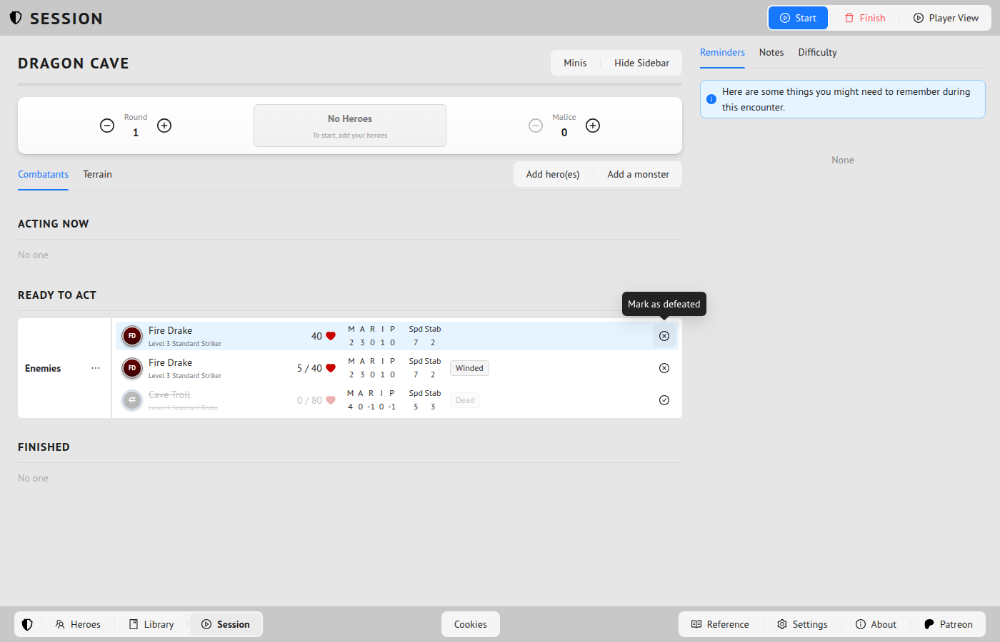
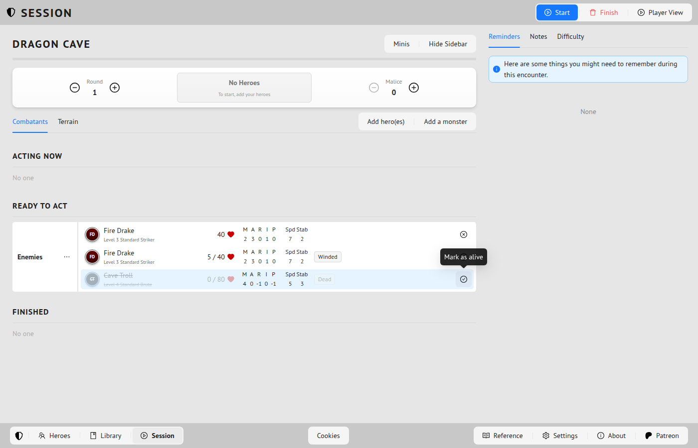

# Forge Steel — Fork Changes

This is a fork of [andyaiken/forgesteel](https://github.com/andyaiken/forgesteel). This file tracks changes made on top of the upstream repo.

## Hosted site

After merging to `main`, the app is automatically deployed to GitHub Pages:
**https://jahteo.github.io/forgesteel/**

---

## Changes

### Sync with upstream (andyaiken/forgesteel `main` @ `3c6b4ab`)

**PR:** [#14](https://github.com/jahteo/forgesteel/pull/14) — `claude/festive-maxwell-i3mo26`

Merges 218 upstream commits into the fork. Upstream reworked the encounter group panel and added its own per-monster Defeated/Active/Hidden popover (`…` menu). The fork's one-click dead/alive toggle is kept alongside it, but now reuses upstream's code: the per-monster button calls upstream's `onSetDefeated`, so the only fork-specific prop left is `onSetSlotDefeated` for the minion-squad button. Also fixes two upstream bugs found along the way: defeating a captain from the `…` menu didn't clear it from its minion squad, and defeated/hidden changes to hero-controlled monsters weren't saved.

**How to test:**
1. Run `npm install`, then `npx vite --host` and open http://localhost:5173
2. Open an encounter and run it
3. Check that the one-click toggle (✕ / ✓ icon) on monster rows and minion squads still flips defeated state, and that upstream's `…` popover on each monster also works
4. Make a monster captain of a minion squad, defeat the captain (via either the ✕ button or the `…` menu), and check the squad shows "No captain"
5. Defeat a minion squad with its ✕ button and check every minion in it is struck through; reload and check it's still defeated

**Files changed:**
- `src/components/panels/encounter-group/encounter-group-panel.tsx` — took upstream layout; one-click buttons now call upstream's `onSetDefeated` (per monster) and a new `onSetSlotDefeated` prop (minion squad)
- `src/components/panels/run/encounter-run/encounter-run-panel.tsx` — removed fork's `toggleMonsterDefeated` / `toggleMinionSlotDefeated`; added `setSlotDefeated`; upstream's `setDefeated` now clears defeated captains; hero-controlled `setMonsterDefeated` / `setMonsterHidden` now call `props.onChange`
- `src/logic/encounter-logic.ts` — new shared helpers `setSlotDefeated` and `clearDefeatedCaptains` (the latter replaces a duplicated inline block)
- `src/components/panels/health/health-panel.tsx` — minion-squad defeat uses `EncounterLogic.setSlotDefeated`
- `src/logic/encounter-logic.test.ts` — tests for the two new helpers
- `package.json` / `package-lock.json` — took upstream dependencies; kept fork's `claude-screenshot-for-pr` / `claude-record-demo-for-pr` scripts plus `tsx` and `@playwright/test`; dropped unused `puppeteer`; added `@types/node` (needed by the fork's `vite.config.ts`, previously pulled in transitively)
- `.gitignore` — kept both sides' entries

**Screenshots:**

| Before | After |
|--------|-------|
|  |  |

**Upstream PR notes:** The sync itself is fork-only. The two bug fixes (captain clean-up in the `…` menu path, missing `props.onChange` for hero-controlled monsters) and the `EncounterLogic` helpers are good upstream candidates on their own; the one-click toggle could follow as a small optional "quick defeat" PR.

### Multi-branch GitHub Pages preview deployments

**PR:** [#7](https://github.com/jahteo/forgesteel/pull/7) — `claude/github-pages-multi-branch-x634e5`

Adds a fork-specific GitHub Actions workflow that automatically deploys every non-`main` branch to a preview URL at `https://jahteo.github.io/forgesteel/preview/<branch-name>/`. When a branch is deleted (e.g. after merging a PR), the workflow automatically removes the corresponding preview subdirectory from the `gh-pages` branch. Also updates the main `github-pages.yml` to use `peaceiris/actions-gh-pages` (deploying to the `gh-pages` branch root) instead of `actions/deploy-pages`, which is required for subdirectory coexistence.

**How to test:**
1. Push any non-`main` branch to `origin`
2. Watch the `Fork — Branch Preview Deploy` workflow run in the Actions tab
3. Visit `https://jahteo.github.io/forgesteel/preview/<slugified-branch-name>/` — app should load
4. Delete the branch (or merge the PR and delete it) — the cleanup job should remove the preview subdirectory

**Files changed:**
- `.github/workflows/fork-branch-previews.yml` — new fork-specific workflow: preview deploy on push, cleanup on branch delete
- `.github/workflows/github-pages.yml` — switched from `actions/deploy-pages` to `peaceiris/actions-gh-pages` for `gh-pages`-branch-based deployment

**Upstream PR notes:** `fork-branch-previews.yml` is entirely fork-specific and should never be upstreamed. The change to `github-pages.yml` is a deployment mechanism swap — hold for upstream until the preview approach is validated. Note: after this PR is merged, the GitHub Pages source in repo Settings must be changed from "GitHub Actions" to "Deploy from a branch → gh-pages / (root)" once the first `gh-pages` branch push has been created.

---

### Playwright screenshot tooling + PR screenshot requirements

**PR:** [#3](https://github.com/jahteo/forgesteel/pull/3) — `claude/playwright-screenshots-aThS7`

Adds a Playwright-based screenshot script so any developer or AI agent can capture the app at any route or element from the command line. Also establishes a hard requirement that every UI-touching PR includes before/after screenshots in its description, enforced via a PR template and documented in `CLAUDE.md`.

**How to test:**
1. Run `npx vite --host` (leave it running)
2. Take a screenshot: `npm run screenshot -- / screenshots/home.png`
3. Verify `screenshots/home.png` was created and shows the app

**Files changed:**
- `scripts/screenshot.ts` — CLI screenshot tool (route, output path, optional CSS selector)
- `playwright.config.ts` — Playwright config with Chromium auto-detection
- `package.json` — added `screenshot` script and `@playwright/test` / `tsx` dev deps
- `CLAUDE.md` — screenshot workflow docs and mandatory PR requirement
- `.github/pull_request_template.md` — pre-fills new PRs with a before/after screenshot table
- `screenshots/.gitkeep` — tracks the screenshots directory in git

**Upstream PR notes:** This is fork-specific infrastructure (the CLAUDE.md AI instructions, PR template with our repo URLs). The `playwright.config.ts` and `scripts/screenshot.ts` are generic and could be upstreamed, but are low priority for upstream since they add a dev dependency. Hold for now.

---

### One-click dead/alive toggle on monster rows

**PR:** [#1](https://github.com/jahteo/forgesteel/pull/1) — `claude/monster-dead-alive-toggle-Qa4Xa`

Adds a single-click toggle button to each monster row (and minion slot header) in the encounter run panel, so a GM can mark a monster as defeated or alive without opening the full health drawer.

- Alive monsters show a ✕ (`CloseCircleOutlined`) button — click to mark defeated
- Defeated monsters show a ✓ (`CheckCircleOutlined`) button — click to mark alive
- Defeated monsters display with a strikethrough name
- Defeating a non-captain cleans up any stale `captainID` references on minion slots
- Defeating a minion slot header marks all monsters in that slot as defeated

**Files changed:**
- `src/components/panels/encounter-group/encounter-group-panel.tsx` — toggle button UI and new `onToggleDefeated` / `onToggleMinionSlotDefeated` props
- `src/components/panels/run/encounter-run/encounter-run-panel.tsx` — `toggleMonsterDefeated` and `toggleMinionSlotDefeated` state handlers

**Screenshots:**





---

### GitHub Pages deployment

**Commit:** `fa42bc9`

Adds a GitHub Actions workflow (`.github/workflows/github-pages.yml`) that builds the Vite app and deploys it to GitHub Pages on every push to `main`. Also supports manual dispatch from any branch via the Actions tab.

- `vite.config.ts` sets `base: '/forgesteel/'` when `GITHUB_PAGES=true` (set by the workflow); local dev is unaffected
- To manually deploy before a PR is merged: **Actions → Deploy to GitHub Pages → Run workflow → select branch**

**One-time setup required:** In repo **Settings → Pages → Source**, select **GitHub Actions**.

---

## Running locally

```bash
git clone https://github.com/jahteo/forgesteel.git
cd forgesteel
npm install
npm run dev
```

App is available at `http://localhost:5173/`.
