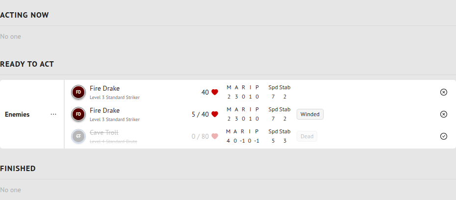

# Forge Steel — Fork Changes

This is a fork of [andyaiken/forgesteel](https://github.com/andyaiken/forgesteel). This file tracks changes made on top of the upstream repo.

## Hosted site

After merging to `main`, the app is automatically deployed to GitHub Pages:
**https://jahteo.github.io/forgesteel/**

---

## Changes

### Backup / restore everything, and session export / import

**PR:** [#16](https://github.com/jahteo/forgesteel/pull/16) — `claude/data-export-import`

Makes the **Backup page** the one place to back up and restore: it now has **Export Everything / Import Everything** (heroes, homebrew sourcebooks, the director session, settings and hidden sourcebooks in one `.ds-backup` file), **Export Session / Import Session** (the running session, with live encounter state, as a `.ds-session` file), and the existing per-hero / per-sourcebook downloads — plus the normal header and footer. After **Export Everything**, and before confirming **Import Everything**, a collapsible tree shows exactly what the backup contains (heroes by party folder, each homebrew sourcebook's contents, the session's encounters/montages/counters, and settings). **Settings → Backup and Restore** has the Export/Import Everything buttons for quick access and a link to the Backup page; the session page's **Save / Load** menu has the session export/import. Previously there was no way to back up a session, and the Backup page only saved heroes and sourcebooks one file at a time.

**How to test:**
1. Run `npx vite --host` and open http://localhost:5173
2. Open **Settings** (footer) → **Backup and Restore** → **Export Everything** — a `Forge Steel Backup <date>.ds-backup` file downloads. Click **Open the Backup Page for more options** — Settings closes and the Backup page opens (also reachable from the welcome page's menu → **Backup**)
3. On the Backup page, change or delete something (e.g. delete a hero first), then **Import Everything...** and pick the file — a summary shows the backup's date and contents; **Replace My Data** → confirm, and the app reloads with the backed-up data
4. Start an encounter and change something (e.g. malice); on the Backup page (or the session page's **Save / Load**) **Export Session**, finish the encounter, then **Import Session...** → **Replace Session** → confirm — the encounter is back as it was

**Files changed:**
- `src/logic/backup-logic.ts` *(new)* — builds, checks, summarises, outlines (as a tree) and restores backups through `DataService` (so it works with local storage and Warehouse/Patreon cloud storage, fetching full heroes where cloud storage only lists summaries); parses session files. Connection settings (which hold access tokens) are deliberately left out of backups
- `src/logic/backup-logic.test.ts` *(new)* — 19 unit tests, including a backup → restore round trip, the contents tree,, full heroes from cloud storage, and rejection of wrong/damaged/newer files
- `src/components/panels/backup/backup-restore-panel.tsx` *(new)* — Export/Import Everything UI, shared by the Backup page and Settings
- `src/components/panels/backup/backup-contents-tree.tsx` *(new)* — the collapsible tree of a backup's contents, shown after export and before import
- `src/components/panels/backup/session-file-panel.tsx` *(new)* — Export/Import Session UI, shared by the Backup page and the session page
- `src/components/pages/backup/backup-page.tsx` / `.scss` — Backup page rebuilt around those panels, with header, footer, and phone layout
- `src/components/modals/settings/settings-modal.tsx` — **Backup and Restore** section (quick buttons + link to the Backup page)
- `src/components/pages/session/director/session-director-page.tsx` — **Save / Load** header menu
- `src/components/main/main.tsx` — `importSession`; Backup page route gets the data service, connection settings and footer
- `src/components/panels/app-footer/app-footer.tsx` — allows `'backup'` as a footer page

**Screenshots:**

| Before | After |
|--------|-------|
|  |  |

Contents tree after exporting (left) and before importing (right):


**Upstream PR notes:** Good upstream candidate — upstream has no session export or whole-app backup either. When merging into the upstream sync (#14), `main.tsx` needs `UpdateLogic.updateSession` instead of `SessionUpdateLogic.updateSession` (upstream centralised its update logic) and the Backup page route moves to upstream's `app-routes.tsx`; `backup-logic.ts` and the two panels don't depend on the update modules.

### Multi-branch GitHub Pages preview deployments

**PR:** [#7](https://github.com/jahteo/forgesteel/pull/7) — `claude/github-pages-multi-branch-x634e5`

Adds a fork-specific GitHub Actions workflow that automatically deploys every non-`main` branch to a preview URL at `https://jahteo.github.io/forgesteel/preview/<branch-name>/`. When a branch is deleted (e.g. after merging a PR), the workflow automatically removes the corresponding preview subdirectory from the `gh-pages` branch. Also updates the main `github-pages.yml` to use `peaceiris/actions-gh-pages` (deploying to the `gh-pages` branch root) instead of `actions/deploy-pages`, which is required for subdirectory coexistence.

**How to test:**
1. Push any non-`main` branch to `origin`
2. Watch the `Fork — Branch Preview Deploy` workflow run in the Actions tab
3. Visit `https://jahteo.github.io/forgesteel/preview/<slugified-branch-name>/` — app should load
4. Delete the branch (or merge the PR and delete it) — the cleanup job should remove the preview subdirectory

**Files changed:**
- `.github/workflows/fork-branch-previews.yml` — new fork-specific workflow: preview deploy on push, cleanup on branch delete
- `.github/workflows/github-pages.yml` — switched from `actions/deploy-pages` to `peaceiris/actions-gh-pages` for `gh-pages`-branch-based deployment

**Upstream PR notes:** `fork-branch-previews.yml` is entirely fork-specific and should never be upstreamed. The change to `github-pages.yml` is a deployment mechanism swap — hold for upstream until the preview approach is validated. Note: after this PR is merged, the GitHub Pages source in repo Settings must be changed from "GitHub Actions" to "Deploy from a branch → gh-pages / (root)" once the first `gh-pages` branch push has been created.

---

### Playwright screenshot tooling + PR screenshot requirements

**PR:** [#3](https://github.com/jahteo/forgesteel/pull/3) — `claude/playwright-screenshots-aThS7`

Adds a Playwright-based screenshot script so any developer or AI agent can capture the app at any route or element from the command line. Also establishes a hard requirement that every UI-touching PR includes before/after screenshots in its description, enforced via a PR template and documented in `CLAUDE.md`.

**How to test:**
1. Run `npx vite --host` (leave it running)
2. Take a screenshot: `npm run screenshot -- / screenshots/home.png`
3. Verify `screenshots/home.png` was created and shows the app

**Files changed:**
- `scripts/screenshot.ts` — CLI screenshot tool (route, output path, optional CSS selector)
- `playwright.config.ts` — Playwright config with Chromium auto-detection
- `package.json` — added `screenshot` script and `@playwright/test` / `tsx` dev deps
- `CLAUDE.md` — screenshot workflow docs and mandatory PR requirement
- `.github/pull_request_template.md` — pre-fills new PRs with a before/after screenshot table
- `screenshots/.gitkeep` — tracks the screenshots directory in git

**Upstream PR notes:** This is fork-specific infrastructure (the CLAUDE.md AI instructions, PR template with our repo URLs). The `playwright.config.ts` and `scripts/screenshot.ts` are generic and could be upstreamed, but are low priority for upstream since they add a dev dependency. Hold for now.

---

### One-click dead/alive toggle on monster rows

**PR:** [#1](https://github.com/jahteo/forgesteel/pull/1) — `claude/monster-dead-alive-toggle-Qa4Xa`

Adds a single-click toggle button to each monster row (and minion slot header) in the encounter run panel, so a GM can mark a monster as defeated or alive without opening the full health drawer.

- Alive monsters show a ✕ (`CloseCircleOutlined`) button — click to mark defeated
- Defeated monsters show a ✓ (`CheckCircleOutlined`) button — click to mark alive
- Defeated monsters display with a strikethrough name
- Defeating a non-captain cleans up any stale `captainID` references on minion slots
- Defeating a minion slot header marks all monsters in that slot as defeated

**Files changed:**
- `src/components/panels/encounter-group/encounter-group-panel.tsx` — toggle button UI and new `onToggleDefeated` / `onToggleMinionSlotDefeated` props
- `src/components/panels/run/encounter-run/encounter-run-panel.tsx` — `toggleMonsterDefeated` and `toggleMinionSlotDefeated` state handlers

**Screenshots:**




---

### GitHub Pages deployment

**Commit:** `fa42bc9`

Adds a GitHub Actions workflow (`.github/workflows/github-pages.yml`) that builds the Vite app and deploys it to GitHub Pages on every push to `main`. Also supports manual dispatch from any branch via the Actions tab.

- `vite.config.ts` sets `base: '/forgesteel/'` when `GITHUB_PAGES=true` (set by the workflow); local dev is unaffected
- To manually deploy before a PR is merged: **Actions → Deploy to GitHub Pages → Run workflow → select branch**

**One-time setup required:** In repo **Settings → Pages → Source**, select **GitHub Actions**.

---

## Running locally

```bash
git clone https://github.com/jahteo/forgesteel.git
cd forgesteel
npm install
npm run dev
```

App is available at `http://localhost:5173/`.
